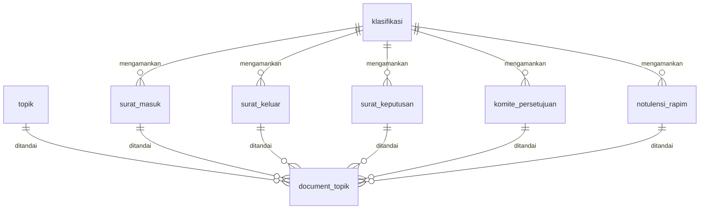

# System Design — SiMPEL v5

Aplikasi manajemen surat masuk & keluar untuk Yayasan Dompet Dhuafa Republika — rebuild dari CodeIgniter 3 ke **Laravel 13**, dengan model **Sekretaris-sebagai-Proxy** (v4) dan penyesuaian frontend ke **Tabler** (v5).

> **Perubahan utama v4 → v5:** Seluruh referensi AdminLTE 4 diganti dengan **Tabler** (Bootstrap 5.3, vanilla JS, 40k+ GitHub stars, MIT license). Tabulator digantikan oleh **DataTable vanilla JS bawaan Tabler** untuk tabel server-side. Semua kelas CSS, komponen, dan konvensi layout mengikuti sistem Tabler.

---

## 1. Mengapa Tabler (bukan AdminLTE 4)

| Aspek | AdminLTE 4 | Tabler |
|---|---|---|
| GitHub Stars | ~44k | ~40k |
| Bootstrap versi | 5.3 | 5.3 |
| jQuery | ❌ (vanilla JS) | ❌ (vanilla JS) |
| Dark mode bawaan | ❌ | ✅ |
| Komponen UI | ~100 | 100+ (lebih polished) |
| Sample pages | ~40 | 200+ |
| Icon set | Font Awesome | Tabler Icons (6.000+ SVG, MIT) |
| Tabel | Tabulator (perlu setup) | DataTable bawaan + integrasi mudah |
| Desain | Classic dashboard | Modern, clean, lebih "product-like" |
| Update terakhir | Aktif | Aktif (Bootstrap 5.3.7, 2026) |
| Lisensi | MIT | MIT |

Untuk SiMPEL, Tabler lebih cocok karena desainnya lebih bersih untuk internal tool sehari-hari, icon set bawaan sudah sangat lengkap (tidak perlu Font Awesome terpisah), dan komponen seperti timeline, badge status, dan card sudah siap pakai tanpa kustomisasi berat.

---

## 2. Perubahan Tech Stack

| Komponen | v4 (sebelumnya) | v5 (sekarang) |
|---|---|---|
| Framework | Laravel 13 | Laravel 13 ✅ sama |
| Frontend template | **AdminLTE 4** (Bootstrap 5.3, vanilla JS) | **Tabler** (Bootstrap 5.3, vanilla JS) |
| Icon | Font Awesome | **Tabler Icons** (SVG inline atau via CDN) |
| Tabel | **Tabulator** (library terpisah) | **DataTable Tabler** (bawaan) atau Tom Select untuk dropdown |
| Chart | Chart.js | **Apache ECharts** (default Tabler) atau tetap Chart.js |
| CSS build | npm + Vite (AdminLTE asset) | **npm + Vite** (Tabler CSS/JS via npm package) |
| Komponen JS | AdminLTE JS | **Tabler JS** (`@tabler/core`) |
| Rich text | — | **HugeRTE** (bawaan Tabler, pengganti TinyMCE) |
| Notifikasi inline | Flash message Bootstrap | **Tabler Alert / Toast** |

Semua komponen lain (Laravel 13, MySQL 8.0, Eloquent, Laravel Breeze, Policy, Event/Listener, Scheduler) **tidak berubah dari v4**.

---

## 3. Instalasi & Setup Tabler di Laravel

### 3.1 Install via npm

```bash
npm install @tabler/core @tabler/icons-webfont
```

### 3.2 `resources/css/app.css`

```css
/* Import Tabler core CSS */
@import "@tabler/core/dist/css/tabler.min.css";
@import "@tabler/core/dist/css/tabler-flags.min.css"; /* opsional */

/* Override custom untuk SiMPEL */
:root {
    --tblr-primary: #206bc4;   /* warna brand DD bisa disesuaikan */
    --tblr-font-sans-serif: 'Inter', sans-serif;
}

/* Custom badge status surat */
.badge-received         { background-color: var(--tblr-secondary); }
.badge-verified         { background-color: var(--tblr-info); }
.badge-forwarded        { background-color: var(--tblr-warning); color: #000; }
.badge-assigned         { background-color: var(--tblr-primary); }
.badge-in-progress      { background-color: var(--tblr-azure); }
.badge-completed        { background-color: var(--tblr-success); }
.badge-archived         { background-color: var(--tblr-muted); }
```

### 3.3 `resources/js/app.js`

```js
// Import Tabler JS
import { TablerApp } from '@tabler/core';

// Import komponen custom SiMPEL
import './simpel/tracking-chart.js';
import './simpel/disposisi-form.js';
import './simpel/surat-table.js';

// Init Tabler
document.addEventListener('DOMContentLoaded', () => {
    TablerApp.init();
});
```

### 3.4 `vite.config.js`

```js
import { defineConfig } from 'vite';
import laravel from 'laravel-vite-plugin';

export default defineConfig({
    plugins: [
        laravel({
            input: ['resources/css/app.css', 'resources/js/app.js'],
            refresh: true,
        }),
    ],
});
```

---

## 4. Layout & Struktur Blade

### 4.1 Layout Utama (`resources/views/layouts/app.blade.php`)

Struktur HTML Tabler berbeda dari AdminLTE. Tabler menggunakan pola `page-wrapper` + `navbar` + `navbar-vertical` (sidebar):

```html
<!doctype html>
<html lang="id">
<head>
    <meta charset="utf-8"/>
    <meta name="viewport" content="width=device-width, initial-scale=1, viewport-fit=cover"/>
    <title>SiMPEL — @yield('title', 'Manajemen Surat')</title>
    @vite(['resources/css/app.css', 'resources/js/app.js'])
</head>
<body class="antialiased">
<div class="wrapper">

    {{-- Sidebar --}}
    <aside class="navbar navbar-vertical navbar-expand-lg">
        <div class="container-fluid">
            <button class="navbar-toggler" type="button" data-bs-toggle="collapse" data-bs-target="#navbar-menu">
                <span class="navbar-toggler-icon"></span>
            </button>
            <h1 class="navbar-brand navbar-brand-autodark">
                <a href="{{ route('dashboard') }}">SiMPEL</a>
            </h1>
            <div class="collapse navbar-collapse" id="navbar-menu">
                <ul class="navbar-nav pt-lg-3">
                    @include('layouts.partials.sidebar-menu')
                </ul>
            </div>
        </div>
    </aside>

    {{-- Main content --}}
    <div class="page-wrapper">
        {{-- Top navbar --}}
        <div class="navbar-expand-md">
            <div class="collapse navbar-collapse" id="navbar-menu">
                <div class="navbar navbar-light">
                    <div class="container-xl">
                        <ul class="navbar-nav flex-row order-md-last">
                            @include('layouts.partials.topbar-user')
                        </ul>
                    </div>
                </div>
            </div>
        </div>

        {{-- Page header --}}
        <div class="page-header d-print-none">
            <div class="container-xl">
                <div class="row g-2 align-items-center">
                    <div class="col">
                        <h2 class="page-title">@yield('page-title')</h2>
                        @hasSection('breadcrumb')
                            <ol class="breadcrumb">@yield('breadcrumb')</ol>
                        @endif
                    </div>
                    <div class="col-auto ms-auto d-print-none">
                        @yield('page-actions')
                    </div>
                </div>
            </div>
        </div>

        {{-- Page body --}}
        <div class="page-body">
            <div class="container-xl">
                @include('layouts.partials.flash-messages')
                @yield('content')
            </div>
        </div>

        @include('layouts.partials.footer')
    </div>
</div>
</body>
</html>
```

### 4.2 Flash Message (Tabler Alert)

```blade
{{-- resources/views/layouts/partials/flash-messages.blade.php --}}
@if(session('success'))
<div class="alert alert-success alert-dismissible" role="alert">
    <div class="d-flex">
        <div><svg xmlns="http://www.w3.org/2000/svg" class="icon alert-icon" width="24" height="24" viewBox="0 0 24 24" stroke-width="2" stroke="currentColor" fill="none"><path stroke="none" d="M0 0h24v24H0z" fill="none"/><path d="M5 12l5 5l10 -10"/></svg></div>
        <div>{{ session('success') }}</div>
    </div>
    <a class="btn-close" data-bs-dismiss="alert" aria-label="close"></a>
</div>
@endif

@if(session('error'))
<div class="alert alert-danger alert-dismissible" role="alert">
    <div>{{ session('error') }}</div>
    <a class="btn-close" data-bs-dismiss="alert" aria-label="close"></a>
</div>
@endif
```

### 4.3 Sidebar Menu Dinamis per Role

```blade
{{-- resources/views/layouts/partials/sidebar-menu.blade.php --}}

@php $role = auth()->user()->role->kode; @endphp

{{-- Semua role: Dashboard --}}
<li class="nav-item">
    <a class="nav-link {{ request()->routeIs('dashboard') ? 'active' : '' }}" href="{{ route('dashboard') }}">
        <span class="nav-link-icon d-md-none d-lg-inline-block">
            <svg xmlns="http://www.w3.org/2000/svg" class="icon" ...>...</svg>
        </span>
        <span class="nav-link-title">Dashboard</span>
    </a>
</li>

@if(in_array($role, ['cc_security', 'sekretaris', 'unit_lain', 'admin']))
<li class="nav-item">
    <a class="nav-link" href="{{ route('penerimaan-surat.index') }}">
        <span class="nav-link-icon">...</span>
        <span class="nav-link-title">Surat Masuk</span>
    </a>
</li>
@endif

@if(in_array($role, ['sekretaris', 'admin']))
<li class="nav-item">
    <a class="nav-link" href="{{ route('verifikasi-surat.index') }}">
        <span class="nav-link-icon">...</span>
        <span class="nav-link-title">Verifikasi</span>
        @php $pending = \App\Models\SuratMasuk::where('status_id', statusId('received'))->count(); @endphp
        @if($pending > 0)
            <span class="badge bg-red ms-auto">{{ $pending }}</span>
        @endif
    </a>
</li>
@endif

@if(in_array($role, ['sekretaris', 'pimpinan', 'admin']))
<li class="nav-item">
    <a class="nav-link" href="{{ route('disposisi.index') }}">
        <span class="nav-link-title">Disposisi</span>
    </a>
</li>
@endif

@if(in_array($role, ['sekretaris', 'unit_lain', 'admin']))
<li class="nav-item">
    <a class="nav-link" href="{{ route('surat-keluar.index') }}">
        <span class="nav-link-title">Surat Keluar</span>
    </a>
</li>
@endif

<li class="nav-item">
    <a class="nav-link" href="{{ route('tracking.index') }}">
        <span class="nav-link-title">Tracking</span>
    </a>
</li>

@if($role === 'admin')
<li class="nav-item dropdown">
    <a class="nav-link dropdown-toggle" href="#" data-bs-toggle="dropdown">
        <span class="nav-link-title">Master Data</span>
    </a>
    <div class="dropdown-menu">
        <a class="dropdown-item" href="{{ route('master.roles.index') }}">Role</a>
        <a class="dropdown-item" href="{{ route('master.klasifikasi.index') }}">Klasifikasi</a>
        <a class="dropdown-item" href="{{ route('master.users.index') }}">User</a>
        <a class="dropdown-item" href="{{ route('master.sekretaris-pimpinan.index') }}">Sekretaris–Pimpinan</a>
    </div>
</li>
@endif
```

---

## 5. Komponen UI Tabler untuk Setiap Modul

### 5.1 Tabel Surat (mengganti Tabulator)

Tabler menyediakan tabel responsif bawaan yang bisa dikombinasi dengan AJAX via `fetch` native. Untuk server-side processing, gunakan `fetch` ke endpoint JSON Laravel:

```html
{{-- resources/views/penerimaan-surat/index.blade.php --}}

@extends('layouts.app')
@section('page-title', 'Surat Masuk')
@section('page-actions')
    @can('create', \App\Models\SuratMasuk::class)
    <a href="{{ route('penerimaan-surat.create') }}" class="btn btn-primary">
        <svg xmlns="http://www.w3.org/2000/svg" class="icon" ...>...</svg>
        Tambah Surat
    </a>
    @endcan
@endsection

@section('content')
<div class="card">
    <div class="card-header">
        <div class="card-options">
            <input type="text" id="search-surat" class="form-control form-control-sm" placeholder="Cari...">
            <select id="filter-status" class="form-select form-select-sm ms-2">
                <option value="">Semua Status</option>
                @foreach($statuses as $s)
                    <option value="{{ $s->kode }}">{{ $s->label }}</option>
                @endforeach
            </select>
        </div>
    </div>
    <div class="table-responsive">
        <table class="table table-vcenter card-table" id="tabel-surat">
            <thead>
                <tr>
                    <th>No. Agenda</th>
                    <th>Pengirim</th>
                    <th>Perihal</th>
                    <th>Tgl Diterima</th>
                    <th>Status</th>
                    <th>Klasifikasi</th>
                    <th class="w-1"></th>
                </tr>
            </thead>
            <tbody id="tabel-surat-body">
                {{-- Diisi via JS fetch --}}
            </tbody>
        </table>
    </div>
    <div class="card-footer d-flex align-items-center">
        <div id="tabel-surat-info" class="text-muted"></div>
        <ul class="pagination ms-auto mb-0" id="tabel-surat-pagination"></ul>
    </div>
</div>
@endsection
```

```js
// resources/js/simpel/surat-table.js

class SuratTable {
    constructor(endpoint) {
        this.endpoint = endpoint;
        this.page = 1;
        this.search = '';
        this.status = '';
        this.init();
    }

    init() {
        document.getElementById('search-surat')
            ?.addEventListener('input', (e) => {
                this.search = e.target.value;
                this.page = 1;
                this.fetch();
            });
        document.getElementById('filter-status')
            ?.addEventListener('change', (e) => {
                this.status = e.target.value;
                this.page = 1;
                this.fetch();
            });
        this.fetch();
    }

    async fetch() {
        const url = new URL(this.endpoint, window.location.origin);
        url.searchParams.set('page', this.page);
        url.searchParams.set('search', this.search);
        url.searchParams.set('status', this.status);

        const res = await fetch(url, {
            headers: { 'Accept': 'application/json', 'X-Requested-With': 'XMLHttpRequest' }
        });
        const data = await res.json();

        this.render(data);
    }

    render(data) {
        const tbody = document.getElementById('tabel-surat-body');
        tbody.innerHTML = data.data.map(s => `
            <tr>
                <td>${s.nomor_agenda}</td>
                <td>${s.pengirim}</td>
                <td>${s.perihal}</td>
                <td>${s.tanggal_diterima}</td>
                <td><span class="badge badge-${s.status_kode}">${s.status_label}</span></td>
                <td><span class="badge bg-${s.klasifikasi_color}">${s.klasifikasi}</span></td>
                <td>
                    <a href="/penerimaan-surat/${s.uuid}" class="btn btn-sm">Detail</a>
                </td>
            </tr>
        `).join('');
        // render pagination...
    }
}

const tabel = document.getElementById('tabel-surat');
if (tabel) {
    new SuratTable('/api/surat-masuk');
}
```

### 5.2 Badge Status Surat

```blade
{{-- resources/views/components/badge-status.blade.php --}}
@props(['status'])

@php
$map = [
    'received'               => ['color' => 'secondary', 'label' => 'Diterima'],
    'verified'               => ['color' => 'info',      'label' => 'Diverifikasi'],
    'forwarded_to_leadership'=> ['color' => 'warning',   'label' => 'Ke Pimpinan'],
    'assigned'               => ['color' => 'primary',   'label' => 'Didisposisikan'],
    'handled_by_leadership'  => ['color' => 'purple',    'label' => 'Pimpinan TL'],
    'in_progress'            => ['color' => 'azure',     'label' => 'Diproses'],
    'completed'              => ['color' => 'success',   'label' => 'Selesai'],
    'archived'               => ['color' => 'dark',      'label' => 'Diarsipkan'],
];
$s = $map[$status] ?? ['color' => 'secondary', 'label' => $status];
@endphp

<span class="badge bg-{{ $s['color'] }}">{{ $s['label'] }}</span>
```

### 5.3 Timeline Riwayat Status (Tabler Steps/Timeline)

Tabler punya komponen `timeline` yang cocok untuk riwayat status surat:

```html
{{-- resources/views/tracking/timeline.blade.php --}}

<ul class="timeline">
    @foreach($riwayat as $r)
    <li class="timeline-event">
        <div class="timeline-event-icon bg-{{ $r->warna }}">
            <svg ...>...</svg>
        </div>
        <div class="card timeline-event-card">
            <div class="card-body">
                <div class="text-muted float-end">{{ $r->waktu->diffForHumans() }}</div>
                <h4>{{ $r->status_ke_label }}</h4>
                <p class="text-muted mb-1">
                    Oleh: <strong>{{ $r->dilakukanOleh->name }}</strong>
                    @if($r->atasNamaPimpinan && $r->atasNamaPimpinan->id !== $r->dilakukan_oleh_id)
                        <span class="text-muted"> — atas nama </span>
                        <strong>{{ $r->atasNamaPimpinan->name }}</strong>
                    @endif
                </p>
                @if($r->catatan)
                    <p class="mb-0">{{ $r->catatan }}</p>
                @endif
            </div>
        </div>
    </li>
    @endforeach
</ul>
```

### 5.4 Dashboard Tracking (Card Stats + ECharts)

```html
{{-- resources/views/tracking/dashboard.blade.php --}}

{{-- Card stats per status --}}
<div class="row row-deck row-cards">
    @foreach($stats as $stat)
    <div class="col-sm-6 col-lg-3">
        <div class="card">
            <div class="card-body">
                <div class="d-flex align-items-center">
                    <div class="subheader">{{ $stat['label'] }}</div>
                </div>
                <div class="h1 mb-3">{{ $stat['count'] }}</div>
                <div class="d-flex mb-2">
                    <div>surat {{ strtolower($stat['label']) }}</div>
                </div>
            </div>
        </div>
    </div>
    @endforeach
</div>

{{-- Chart ECharts --}}
<div class="card mt-3">
    <div class="card-header">
        <h3 class="card-title">Tren Surat Masuk (30 hari terakhir)</h3>
    </div>
    <div class="card-body">
        <div id="chart-tren" style="height: 300px;" data-url="{{ route('api.tracking.chart') }}"></div>
    </div>
</div>
```

### 5.5 Form Disposisi (Modal atau Full Page)

Untuk UX yang lebih baik, form disposisi bisa ditampilkan sebagai **Tabler Modal** (tanpa reload) saat dipanggil dari daftar surat, atau sebagai full page untuk detail:

```html
{{-- Modal disposisi --}}
<div class="modal modal-blur fade" id="modal-disposisi" tabindex="-1" role="dialog" aria-hidden="true">
    <div class="modal-dialog modal-lg modal-dialog-centered" role="document">
        <div class="modal-content">
            <div class="modal-header">
                <h5 class="modal-title">Disposisi Surat</h5>
                <button type="button" class="btn-close" data-bs-dismiss="modal"></button>
            </div>
            <form method="POST" id="form-disposisi">
                @csrf
                <div class="modal-body">
                    {{-- Dropdown Atas Nama (hanya untuk Sekretaris) --}}
                    @if(auth()->user()->role->kode === 'sekretaris')
                    <div class="mb-3">
                        <label class="form-label required">Atas Nama Pimpinan</label>
                        <select name="atas_nama_pimpinan_id" class="form-select" required>
                            <option value="">-- Pilih Pimpinan --</option>
                            @foreach(auth()->user()->pimpinanYangDilayani as $p)
                                <option value="{{ $p->id }}">{{ $p->name }}</option>
                            @endforeach
                        </select>
                        <small class="form-hint">Disposisi dicatat atas nama pimpinan yang dipilih.</small>
                    </div>
                    @endif

                    {{-- Jenis Disposisi --}}
                    <div class="mb-3">
                        <label class="form-label required">Jenis Disposisi</label>
                        <div class="form-selectgroup">
                            <label class="form-selectgroup-item">
                                <input type="radio" name="jenis" value="ke_pelaksana" class="form-selectgroup-input" id="jenis-pelaksana">
                                <span class="form-selectgroup-label">Ke Pelaksana</span>
                            </label>
                            <label class="form-selectgroup-item">
                                <input type="radio" name="jenis" value="langsung_pimpinan" class="form-selectgroup-input" id="jenis-langsung">
                                <span class="form-selectgroup-label">Tindak Lanjut Langsung</span>
                            </label>
                        </div>
                    </div>

                    {{-- Conditional: ke pelaksana --}}
                    <div id="section-pelaksana" class="d-none">
                        <div class="mb-3">
                            <label class="form-label">Pelaksana</label>
                            <select name="pelaksana_id" class="form-select">
                                {{-- diisi via fetch atau server render --}}
                            </select>
                        </div>
                        <div class="mb-3">
                            <label class="form-label">Deadline</label>
                            <input type="date" name="tanggal_deadline" class="form-control">
                        </div>
                    </div>

                    {{-- Conditional: langsung pimpinan --}}
                    <div id="section-langsung" class="d-none">
                        <div class="mb-3">
                            <label class="form-label">Catatan Tindak Lanjut</label>
                            <textarea name="catatan_pimpinan" class="form-control" rows="4"></textarea>
                        </div>
                    </div>
                </div>
                <div class="modal-footer">
                    <button type="button" class="btn btn-link link-secondary me-auto" data-bs-dismiss="modal">Batal</button>
                    <button type="submit" class="btn btn-primary">Simpan Disposisi</button>
                </div>
            </form>
        </div>
    </div>
</div>
```

---

## 6. Struktur Direktori (Diperbarui)

```
simpel-laravel/
├── app/                          (sama seperti v4)
│
├── resources/
│   ├── views/
│   │   ├── layouts/
│   │   │   ├── app.blade.php             # Layout utama Tabler (page-wrapper)
│   │   │   └── partials/
│   │   │       ├── sidebar-menu.blade.php
│   │   │       ├── topbar-user.blade.php
│   │   │       ├── flash-messages.blade.php
│   │   │       └── footer.blade.php
│   │   ├── components/
│   │   │   ├── badge-status.blade.php    # <x-badge-status :status="$surat->status->kode" />
│   │   │   ├── badge-klasifikasi.blade.php
│   │   │   ├── modal-disposisi.blade.php
│   │   │   └── timeline-item.blade.php
│   │   ├── penerimaan-surat/
│   │   ├── verifikasi-surat/
│   │   ├── disposisi/
│   │   ├── tracking/
│   │   ├── surat-keluar/
│   │   └── master/
│   │
│   ├── js/
│   │   ├── app.js                        # Init Tabler + import modul
│   │   └── simpel/
│   │       ├── surat-table.js            # Tabel fetch native (ganti Tabulator)
│   │       ├── tracking-chart.js         # ECharts setup + polling
│   │       ├── disposisi-form.js         # Toggle conditional section disposisi
│   │       └── nomor-surat.js            # Saran nomor surat keluar
│   │
│   └── css/
│       └── app.css                       # Import Tabler + override SiMPEL
│
├── package.json
│   # dependencies: @tabler/core, @tabler/icons-webfont
│   # devDependencies: vite, laravel-vite-plugin
│
└── vite.config.js
```

---

## 7. Hal yang Tidak Berubah dari v4

Semua arsitektur backend, business logic, dan database tetap sama:

- Model Sekretaris-sebagai-Proxy (tabel `sekretaris_pimpinan`, kolom proxy di `disposisi` & `riwayat_status`)
- `SuratScopeService`, `WorkflowService`, `AksesKlasifikasiService`
- Semua Actions (`BuatDisposisi`, `VerifikasiSurat`, `ArsipakanSurat`)
- Laravel Policy & Gate (RBAC + klasifikasi)
- Audit trail via Event/Listener (`SuratStatusChanged` → `CatatRiwayatStatus`)
- SLA Reminder via Laravel Scheduler
- Enkripsi lampiran Rahasia (`Storage::disk('rahasia')` + `Crypt`)
- Notifikasi sinkron (Laravel Notification, channel mail + database)
- Strategi migrasi dari CI3 (Strangler pattern, 4 fase)
- Autentikasi via Laravel Breeze

---

## 8. Notifikasi Email Disposisi

> **Tambahan v5 (inkremen):** notifikasi email otomatis ke penerima disposisi, dengan konfigurasi SMTP dinamis dari halaman Pengaturan dan log pengiriman yang dapat diaudit. Diimplementasikan setelah rilis Tabler v5.

### 8.1 Alur Kirim Email

1. User membuat disposisi (modal/form) atau memindahkan disposisi (`pindah`).
2. `BuatDisposisi` (action) menyelesaikan pembuatan disposisi + status surat, lalu memanggil `EmailService`.
3. `EmailService` membangun daftar penerima:
   - **Penerima user aplikasi** → email diambil otomatis dari tabel `users.email`.
   - **Penerima freetext** → email diambil dari format `Nama <email>` pada field `disposisi_kepada` (disimpan sebagai array JSON). Freetext tanpa email **tidak** dikirim.
4. Email HTML dikirim (subject + body berisi detail surat & disposisi, tautan ke detail surat).
5. Setiap percobaan tercatat di `email_notification_logs` dengan status `sent`/`failed`.

### 8.2 Konfigurasi SMTP Dinamis

Konfigurasi **tidak** dibaca dari `.env` (Laravel default) melainkan dari tabel `settings` (key prefix `smtp_*`), sehingga admin bisa mengubahnya via UI tanpa deploy. Driver didukung:

| Driver | Deskripsi | Default Host / Port |
|---|---|---|
| `smtp` | SMTP standar / PHP Mailer (sembarang provider) | sesuai isian |
| `mailersend` | MailerSend | `smtp.mailersend.net` : 587 (API key dipakai sebagai username+password) |
| `sendgrid` | SendGrid | `smtp.sendgrid.net` : 587 (username `apikey`, password = API key) |
| `gmail` | Google Mail (Gmail/Workspace) via App Password | `smtp.gmail.com` : 587 TLS |

Semua driver memakai **transport SMTP native Laravel** — tidak memerlukan package driver tambahan (MailerSend/SendGrid/Gmail semuanya mendukung SMTP). `EmailService::createMailer()` membuat mailer dinamis per-konfigurasi (nama mailer unik via `md5(serialize(config))`), lalu `Mail::mailer(...)->html(...)`.

Field settings yang digunakan:

```
smtp_enabled          smtp_driver           smtp_host
smtp_port             smtp_username         smtp_password
smtp_encryption       smtp_from_address     smtp_from_name
mailersend_api_key    sendgrid_api_key
gmail_client_id       gmail_client_secret   gmail_refresh_token  (OAuth opsional, fallback App Password)
```

### 8.3 Tabel `email_notification_logs`

```php
Schema::create('email_notification_logs', function (Blueprint $table) {
    $table->id();
    $table->string('uuid')->unique();
    $table->string('type');                 // 'disposisi', 'general'
    $table->unsignedBigInteger('reference_id')->nullable();  // disposisi_id
    $table->string('recipient_type');       // 'user' | 'freetext'
    $table->unsignedBigInteger('recipient_user_id')->nullable();
    $table->string('recipient_name');
    $table->string('recipient_email');
    $table->string('subject');
    $table->text('body')->nullable();
    $table->string('status');               // 'pending' | 'sent' | 'failed'
    $table->text('error_message')->nullable();
    $table->string('mailer_used')->nullable();
    $table->timestamp('sent_at')->nullable();
    $table->timestamps();
    // indexes: [type, reference_id], recipient_user_id, status, created_at
});
```

### 8.4 Service & Komponen

| Komponen | Lokasi | Tanggung Jawab |
|---|---|---|
| `EmailService` | `app/Services/EmailService.php` | `send()`, `sendToMultiple()`, `createMailer()` (SMTP dinamis), `testConnection()` |
| `EmailNotificationLog` | `app/Models/EmailNotificationLog.php` | Model log, scope `sent`/`failed` |
| `BuatDisposisi` | `app/Actions/BuatDisposisi.php` | Kirim notifikasi ke semua penerima setelah disposisi dibuat |
| `DisposisiController@pindah` | `app/Http/Controllers/DisposisiController.php` | Kirim notifikasi ke pelaksana baru |
| `SettingController@index/update/testSmtp` | `app/Http/Controllers/Master/SettingController.php` | UI konfigurasi + uji koneksi |

### 8.5 Endpoint

| Method | Route | Fungsi |
|---|---|---|
| `POST` | `master/settings/test-smtp` | Uji koneksi SMTP + kirim email uji (JSON) |
| `GET` | `master/settings` | Pengaturan (tab Email/SMTP + tab Log pengiriman) |

### 8.6 UI

- **Pengaturan → tab Email/SMTP**: toggle aktif, dropdown driver, form per driver (smtp host/port/user/pass, MailerSend/SendGrid API key, Gmail app password), dari alamat/nama, tombol **Test Koneksi & Kirim Email Uji**.
- **Pengaturan → tab Log Pengiriman Email**: tabel log (waktu, jenis, penerima, email, subjek, status) + popover pesan error untuk log gagal.
- **Form disposisi (modal & edit)**: penerima freetext kini punya kolom email wajib. Disimpan sebagai `Nama <email>` di `disposisi_kepada`.
- **History Surat → tab Notifikasi Email**: timeline status terkirim/gagal per surat (diambil dari log `type=disposisi` untuk disposisi milik surat tsb).

### 8.7 Catatan Operasional

- Email **nonaktif** secara default (`smtp_enabled = 0`). Aktivasi via Pengaturan.
- Untuk Gmail wajib **App Password** (2FA aktif). App password 16 karakter.
- Kegagalan kirim tidak menggagalkan pembuatan disposisi — error tercatat di log (best-effort).
- `Setting::set()` kini `updateOrCreate`, sehingga key baru otomatis dibuat saat disimpan.

---

*Dokumen ini adalah revisi dari v4: mengganti frontend template dari AdminLTE 4 ke Tabler, menyesuaikan konvensi CSS/JS/HTML ke sistem Tabler (page-wrapper, navbar-vertical, card, badge, timeline, modal), mengganti Tabulator dengan fetch native + tabel Tabler, dan mengganti ikon Font Awesome dengan Tabler Icons. Semua backend, database, dan business logic tidak berubah dari v4 — ditambah modul **Notifikasi Email Disposisi** (§8) dan **Refactor Klasifikasi-Topik** (§9).*

---

## 9. Refactor Klasifikasi — Pemisahan Level Keamanan dan Topik

> **Tambahan v5 (inkremen):** Refactor sistem `klasifikasi` di SiMPEL untuk memisahkan dua kepentingan secara bersih: **level keamanan** (Umum, Terbatas, Rahasia) dan **topik/subjek** (Keuangan, SDM, Program, Penghimpunan). Saat ini, tabel `klasifikasi` mencampur kedua hal ini dalam satu tabel yang sama.

### 9.1 Masalah Saat Ini

Tabel `kolom` `klasifikasi` menyimpan entri level keamanan (UMUM, RAHASIA, restricted) DAN entri topik (KEUANGAN, SDM, PROGRAM) di tabel yang sama. Hal ini menyebabkan:

- Tidak bisa menandai dokumen dengan beberapa topik sekaligus
- Kolom `is_rahasia` di tabel dokumen bersifat redundan (seharusnya diturunkan dari klasifikasi)
- Filtering dan pencarian sulit membedakan level keamanan vs topik

### 9.2 Arsitektur Target



**Keputusan Arsitektur Utama:**
1. `klasifikasi` mempertahankan struktur yang ada, namun di-reseed hanya berisi 3 entri level keamanan
2. Tabel baru `topik` memiliki struktur mirip `klasifikasi` (id, uuid, kode, nama, deskripsi, color)
3. Tabel pivot polimorfik `document_topik` menghubungkan topik ke tipe dokumen apapun
4. `is_rahasia` dihapus dari tabel dokumen; diturunkan dari `klasifikasi.kode IN ('TERBATAS', 'RAHASIA')`
5. Kolom `is_rahasia` pada tabel `klasifikasi` tetap dipertahankan untuk kompatibilitas mundur dengan `AksesKlasifikasiService`

### 9.3 Komponen dan Interface

#### 9.3.1 Model & Migration Topik

**Migration:** `create_topik_table`
```php
Schema::create('topik', function (Blueprint $table) {
    $table->id();
    $table->uuid('uuid')->unique();
    $table->string('kode', 50)->unique();
    $table->string('nama');
    $table->text('deskripsi')->nullable();
    $table->string('color', 20)->default('secondary');
    $table->timestamps();
});
```

**Migration Pivot:** `create_document_topik_table`
```php
Schema::create('document_topik', function (Blueprint $table) {
    $table->id();
    $table->string('document_type'); // contoh: 'App\Models\SuratMasuk'
    $table->unsignedBigInteger('document_id');
    $table->unsignedBigInteger('topik_id');
    $table->foreign('topik_id')->references('id')->on('topik')->cascadeOnDelete();
    $table->unique(['document_type', 'document_id', 'topik_id']);
});
```

**Model:** `app/Models/Topik.php`
- Field: `uuid`, `kode`, `nama`, `deskripsi`, `color`
- Method: `isAppliedTo($document)` — memeriksa apakah topik ini diterapkan ke dokumen tertentu

#### 9.3.2 Update Seeder Klasifikasi

Ganti seeder 6 record saat ini menjadi tepat 3 record level keamanan:

| kode | nama | is_rahasia |
|------|------|-----------|
| UMUM | Public | false |
| TERBATAS | Restricted | true |
| RAHASIA | Confidential | true |

Record `restricted` yang ada akan di-rename menjadi `TERBATAS` untuk konsistensi. Record `KEUANGAN`, `SDM`, `PROGRAM` dimigrasikan ke tabel `topik` baru.

#### 9.3.3 Seeder Topik

Seed topik awal:

| kode | nama |
|------|------|
| KEUANGAN | Keuangan |
| SDM | Sumber Daya Manusia |
| PROGRAM | Program |
| PENGHIMPUNAN | Penghimpunan |

#### 9.3.4 Update Model Dokumen

Semua 5 model dokumen (SuratMasuk, SuratKeluar, SuratKeputusan, KomitePersetujuan, NotulensiRapim) mendapat:

**Relasi baru:**
```php
public function topiks()
{
    return $this->morphToMany(Topik::class, 'document');
}
```

**Accessor baru:**
```php
public function getIsRahasiaAttribute(): bool
{
    return in_array($this->klasifikasi?->kode, ['TERBATAS', 'RAHASIA']);
}
```

**Dihapus dari `$fillable`:** `is_rahasia`

**Tambahan model Klasifikasi:**
```php
public function isRahasia(): bool
{
    return $this->is_rahasia || in_array($this->kode, ['TERBATAS', 'RAHASIA']);
}
```

#### 9.3.5 Perubahan Controller

**PenerimaanSuratController:**
- `create()` / `edit()`: Kirim `$topiks = Topik::orderBy('nama')->get()` bersamaan `$klasifikasi`
- `store()` / `update()`: Sinkron pilihan topik via `$surat->topiks()->sync($request->input('topik_ids', []))`
- Hapus assignment `is_rahasia` dari data request

**SuratKeluarController:**
- Pola sama dengan PenerimaanSuratController

**Controller Arsip (SuratKeputusan, KomitePersetujuan, NotulensiRapim):**
- Update form view untuk menerima `$topiks` dari controller alih-alih query inline
- Sinkron relasi topik pada store/update

**KlasifikasiController:**
- Hapus `is_rahasia` dari form create/edit (diturunkan otomatis)
- Atau pertahankan agar bisa diedit secara manual

#### 9.3.6 Perubahan Service

**AksesKlasifikasiService:**
- `canAccess()`: Ganti pengecekan `$klasifikasi->is_rahasia` dengan method call `$klasifikasi->isRahasia()`
- `getVisibleKlasifikasi()`: Filter menggunakan `isRahasia()` alih-alih kolom `is_rahasia`

**SuratScopeService:**
- `scopeSuratRestricted()`: Ganti referensi kolom `is_rahasia` langsung dengan pengecekan relasi klasifikasi
- Tambah dukungan filtering berbasis topik

**DocumentSearchService:**
- Perluas pencarian untuk memasukkan `topik.nama` sebagai field searchable tambahan
- Tambah parameter filter opsional `$topikId`

#### 9.3.7 Perubahan Policy

**SuratMasukPolicy:**
- Ganti `$surat->is_rahasia` (kolom) dengan `$surat->is_rahasia` (accessor)

**SuratKeputusanPolicy, KomitePersetujuanPolicy, NotulensiRapimPolicy:**
- Pola sama: gunakan accessor alih-alih kolom

#### 9.3.8 Perubahan View

**Form view (8 form):**
- Tambah input chip/tag multi-select untuk pemilihan topik
- Gunakan Alpine.js atau sejenisnya untuk UX multi-select berbasis chip
- Setiap form perlu: `<select name="topik_ids[]" multiple>`

**Komponen Badge (`badge-klasifikasi.blade.php`):**
- Rename menjadi `badge-security-level.blade.php` agar lebih jelas
- Tambah komponen baru `badge-topik.blade.php` untuk tampilan topik

**View index/daftar (4+ view):**
- Tambah kolom topik atau badge topik di samping badge klasifikasi
- Tambah dropdown filter topik

**View show/detail:**
- Tampilkan tag topik yang ditugaskan
- Hapus referensi kolom `is_rahasia` langsung; gunakan accessor

**surat-table.js:**
- Tambah rendering topik di tabel AJAX
- Tambah dukungan filter topik

### 9.4 Strategi Migrasi Data

Migrasi harus:
1. Buat tabel `topik` dan pivot `document_topik`
2. Migrasi record topik (KEUANGAN, SDM, PROGRAM, PENGHIMPUNAN) dari `klasifikasi` ke `topik`
3. Migrasi relasi dokumen-topik yang ada: dimana `klasifikasi_id` menunjuk ke record topik, buat entry pivot
4. Reseed `klasifikasi` hanya berisi level keamanan
5. Drop kolom `is_rahasia` dari surat_masuk, surat_keputusan, komite_persetujuan, notulensi_rapim
6. Pertahankan `is_rahasia` di tabel klasifikasi untuk kompatibilitas mundur

### 9.5 Model Data

#### Tabel Baru

**topik:**
| Kolom | Tipe | Constraint |
|-------|------|-----------|
| id | bigint PK | auto-increment |
| uuid | uuid | unique |
| kode | varchar(50) | unique |
| nama | varchar | |
| deskripsi | text | nullable |
| color | varchar(20) | default 'secondary' |
| timestamps | | |

**document_topik:**
| Kolom | Tipe | Constraint |
|-------|------|-----------|
| id | bigint PK | auto-increment |
| document_type | varchar | |
| document_id | bigint | |
| topik_id | bigint FK | references topik.id cascadeOnDelete |
| unique constraint | | (document_type, document_id, topik_id) |

#### Tabel yang Diubah

**klasifikasi:**
- Hapus record: KEUANGAN, SDM, PROGRAM
- Rename `restricted` menjadi `TERBATAS`
- Pertahankan kolom `is_rahasia` (untuk kompatibilitas mundur, auto-set berdasarkan kode)

**surat_masuk, surat_keputusan, komite_persetujuan, notulensi_rapim:**
- Drop kolom `is_rahasia`

**surat_keluar:**
- Tidak ada perubahan (tidak pernah punya is_rahasia)

### 9.6 Properti Kevalidan

| # | Properti | Deskripsi |
|---|---------|-----------|
| 1 | Klasifikasi berisi tepat 3 level keamanan | Untuk semua state database, tabel `klasifikasi` berisi tepat 3 record dengan kode UMUM, TERBATAS, dan RAHASIA |
| 2 | Is-rahasia diturunkan dari relasi klasifikasi | Untuk setiap dokumen dengan klasifikasi yang ditugaskan, accessor `is_rahasia` mengembalikan `true` jika dan hanya jika kode klasifikasi adalah 'TERBATAS' atau 'RAHASIA' |
| 3 | Tidak ada kolom is_rahasia di tabel dokumen | Untuk semua tabel dokumen, kolom boolean `is_rahasia` tidak ada setelah migrasi |
| 4 | Multi-select topik tersimpan dengan benar | Untuk setiap dokumen, setelah sync topik_ids, tabel pivot `document_topik` berisi tepat asosiasi topik yang ditentukan |
| 5 | Tampilan topik menampilkan semua topik yang ditugaskan | Untuk setiap dokumen dengan topik yang ditugaskan, view display merender semua nama topik sebagai tag/chip |
| 6 | Filter topik mengembalikan subset yang benar | Untuk setiap filter topik yang diterapkan pada query dokumen, hasil hanya berisi dokumen yang memiliki topik yang dipilih |
| 7 | Filter klasifikasi mengembalikan subset yang benar | Untuk setiap filter klasifikasi yang diterapkan pada query dokumen, hasil hanya berisi dokumen dengan klasifikasi_id yang cocok |
| 8 | Topik opsional di semua form | Untuk setiap pengiriman form dokumen tanpa topik_ids, dokumen berhasil disimpan tanpa asosiasi topik |
| 9 | Kontrol akses menggunakan relasi klasifikasi | Untuk setiap pengecekan akses pada dokumen, sistem menentukan akses terbatas dengan memeriksa relasi klasifikasi, bukan membaca kolom langsung dari tabel dokumen |
| 10 | Pencarian mencakup topik | Untuk setiap kueri pencarian dokumen, sistem mengembalikan dokumen di mana istilah pencarian cocok dengan nama klasifikasi ATAU nama topik ATAU field spesifik dokumen |

### 9.7 Penanganan Error

**Error Migrasi:**
- Jika migrasi menemukan masalah integritas data (misal klasifikasi_ids yang terputus), log error dan hentikan, izinkan penyelesaian manual
- Backup database sebelum menjalankan migrasi

**Validasi Form:**
- Pemilihan topik bersifat opsional; tidak ada error validasi jika kosong
- Pemilihan klasifikasi bersifat wajib; error validasi jika tidak diberikan
- Duplikat asosiasi topik dicegah oleh constraint unique pada pivot table

**Fallback Kontrol Akses:**
- Jika dokumen tidak memiliki klasifikasi yang ditugaskan, default ke level akses Public (UMUM)
- Jika relasi klasifikasi null, accessor `is_rahasia` mengembalikan `false`

### 9.8 Strategi Pengujian

**Unit Tests:**
- Test operasi CRUD model `Topik`
- Test accessor `is_rahasia` pada semua 5 model dokumen
- Test method `Klasifikasi::isRahasia()`
- Test otorisasi policy dengan pola akses baru

**Property Tests:**
- Properti 1: Reseeding menyisakan tepat 3 record klasifikasi
- Properti 2: Accessor is_rahasia cocok dengan kode klasifikasi untuk semua dokumen
- Properti 3: Kolom is_rahasia dihapus dari tabel dokumen
- Properti 4: Sync topik membuat entry pivot yang benar
- Properti 6: Filter topik mengembalikan subset yang benar
- Properti 8: Form menerima pilihan topik kosong

**Integration Tests:**
- Test alur CRUD lengkap untuk setiap tipe dokumen dengan penugasan topik
- Test AksesKlasifikasiService dengan data klasifikasi-only baru
- Test DocumentSearchService dengan pencarian berbasis topik
- Test migrasi mempertahankan integritas data yang ada
